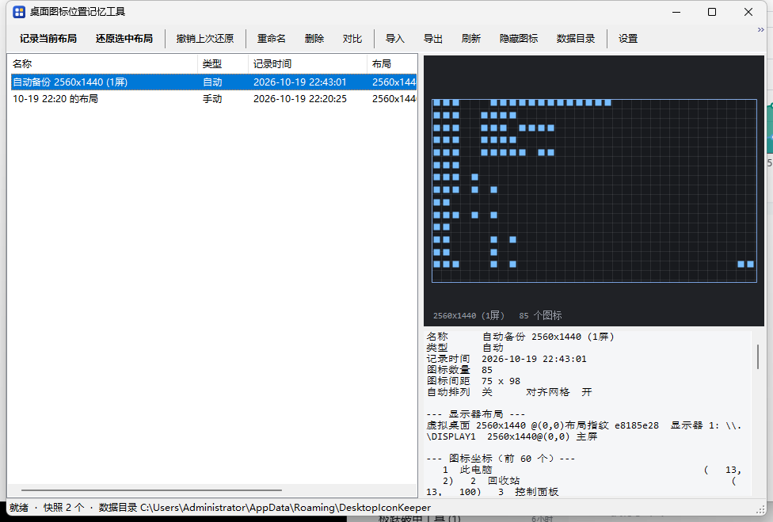

# 桌面图标位置记忆工具 · DesktopIconKeeper

[](LICENSE)
[](#)
[](#)
[](#)
[](#交流群)

一键记录、一键还原 Windows 桌面图标的位置布局。单文件 exe，自带界面，**不依赖任何运行时**。

```
dist\DesktopIconKeeper.exe     约 171 KB，Win10 / Win11 双击即用
```

**中英双语** · 图标过渡动画 · 一键隐藏桌面图标 · 关机前自动备份 · 显示器变化自动还原



---

## 为什么需要它

Windows 把桌面图标坐标**按分辨率分开存储**。只要发生下面任何一件事，你精心摆好的图标就会被打乱：

- 改分辨率 / 刷新率（全屏游戏、远程桌面）
- 插拔外接显示器、笔记本上/下扩展坞
- 切换主显示器、改缩放比例
- 显卡驱动更新、explorer.exe 重启

本工具把「某个显示器布局下的一整套图标坐标」存成快照，之后一键写回去。

---

## 快速开始

1. 双击 `DesktopIconKeeper.exe`
2. 点 **记录当前布局**，起个名字（例如「工作布局」）
3. 图标乱了以后，选中该快照，点 **还原选中布局**

全局热键（可改）：

| 热键 | 动作 |
|---|---|
| `Ctrl + Alt + S` | 记录当前布局 |
| `Ctrl + Alt + R` | 还原最近一次手动快照 |

窗口关闭按钮 = 最小化到托盘，托盘右键退出。

---

## 语言

界面支持简体中文和英文，**默认跟随系统语言**（系统是中文就用中文，否则用英文）。

| 设置里的「语言」 | 行为 |
|---|---|
| 自动（跟随系统） | 读系统 UI 语言：中文 → 简体中文，其余 → English |
| 简体中文 | 锁定中文 |
| English | 锁定英文 |

切换后立即生效，**命令行输出也跟着变**：

```bat
DesktopIconKeeper.exe doctor
:: 中文系统 -> === 桌面图标位置记忆工具 · 环境诊断 ===
:: 英文系统 -> === Desktop Icon Keeper · Environment diagnostics ===
```

翻译表在 `src\LangTable.cs`，**中文原文就是 key**，不用维护两份。漏翻的条目会原样显示中文（不会变成空白），一眼就能看出来。

---

## 交流群

QQ 群：**606140489**

设置窗口底部有一行可点击的群号，点一下复制到剪贴板。

---

## 功能

### 核心

| 功能 | 说明 |
|---|---|
| **一键记录** | 抓取全部图标的名称 + 坐标 + 显示器布局指纹 + 图标间距 |
| **一键还原** | 按**名称**匹配写回坐标（不依赖图标顺序），带自动回读校验 |
| 多快照管理 | 命名 / 重命名 / 删除 / 复制，列表按时间倒序 |
| **撤销上次还原** | 每次还原前自动存撤销点，一键回退 |
| **还原校验** | 写入后重新读取比对，报告「已就位 N/M」，被系统吸附的单独列出 |
| 导入 / 导出 | 快照是带缩进的 JSON，可手工编辑、跨机迁移 |
| 托盘 + 全局热键 | 后台常驻，热键随时可用 |

### 增强

| 功能 | 说明 |
|---|---|
| **显示器变化自动备份** | 监听显示设置变化，等 explorer 重排结束后为新布局建立备份 |
| **切回已知布局自动还原** | 回到某个已知显示器布局时自动把图标摆回去（插拔坞站、游戏改分辨率、RDP 都能覆盖） |
| **迷你桌面地图** | 右侧缩略图按比例画出每台显示器和每个图标，鼠标悬浮显示名称 |
| **快照差异对比** | 选中 1 个 → 与当前桌面对比；选中 2 个 → 两个快照互相对比 |
| 忽略列表 | 回收站等图标不参与记录与还原 |
| 跨分辨率缩放 | 布局指纹不一致时可按分辨率比例缩放坐标 |
| 未记录图标归位 | 可选把新图标排到桌面右侧空位，而不是留在原处 |
| 自动关闭「自动排列」 | 检测到自动排列开启时自动关闭（否则写入会被系统立刻重排） |
| 开机自启 + 静默模式 | HKCU Run，不需要管理员权限 |
| 绿色模式 | exe 同目录放一个 `portable.txt`，数据改存程序旁边 |
| 深色友好的预览面板 | 与系统主题无关，始终可读 |
| **图标过渡动画** | 还原时图标分帧滑向目标位置，而不是瞬移（纯视觉，不影响最终坐标） |
| **隐藏 / 显示桌面图标** | 一键隐藏或显示全部桌面图标，等价于桌面右键 → 查看 → 显示桌面图标 |
| **关机前自动备份** | 关机 / 注销前抢存一份快照 —— 图标乱序多半就是关机时造成的 |
| **中英双语界面** | 跟随系统语言自动切换，也可在设置里手动锁定 |

---

## 界面

```
┌──────────────────────────────────────────────────────────────────────┐
│ [记录当前布局] [还原选中布局] │ 撤销 │ 重命名 删除 对比 │ … 隐藏图标 设置 │
├────────────────────────────┬─────────────────────────────────────────┤
│ 名称        类型  记录时间  │  迷你桌面地图                           │
│ 工作布局    手动  02-14 …   │   ┌───────────────────────────┐         │
│ 游戏1080P   手动  02-14 …   │   │ ▪ ▪ ▪ ▪                   │         │
│ 自动备份…   自动  02-14 …   │   │ ▪ ▪ ▪                     │         │
│                            │   └───────────────────────────┘         │
│                            │  明细：名称 / 类型 / 布局 / 坐标表       │
├────────────────────────────┴─────────────────────────────────────────┤
│ 2560x1440 (1屏) · 指纹 e8185e28 · 85 个图标 · 自动排列：关            │
└──────────────────────────────────────────────────────────────────────┘
```

---

## 命令行

同一个 exe 支持命令行，可被计划任务 / 批处理调用。

```
DesktopIconKeeper.exe save <名称>          记录当前布局
DesktopIconKeeper.exe restore <名称>       还原指定快照
DesktopIconKeeper.exe restore --last       还原最近一次手动快照
DesktopIconKeeper.exe list                 列出所有快照
DesktopIconKeeper.exe diff <A> <B>         对比（--current 表示当前桌面）
DesktopIconKeeper.exe delete <名称>        删除快照
DesktopIconKeeper.exe export <名称> <文件> 导出为 JSON
DesktopIconKeeper.exe icons hide           隐藏桌面图标
DesktopIconKeeper.exe icons show           显示桌面图标
DesktopIconKeeper.exe icons toggle         切换（隐藏 ⇄ 显示）
DesktopIconKeeper.exe icons status         只查状态
DesktopIconKeeper.exe doctor               环境诊断
DesktopIconKeeper.exe uicheck              界面自检
DesktopIconKeeper.exe denied-preview       只弹「权限不足」对话框（排版预览 / 截图用）
DesktopIconKeeper.exe settings-preview     只弹设置窗口（排版预览 / 截图用）
DesktopIconKeeper.exe version              版本
```

退出码：`0` 成功 / `1` 完成但有偏差 / `2` 桌面视图不可用 / `3` 找不到快照 / `4` 被自动排列阻止 / `5` 用法错误。

示例：登录后自动摆好图标 ——

```bat
"C:\Tools\DesktopIconKeeper.exe" restore --last
```

---

## 数据位置

| 模式 | 路径 |
|---|---|
| 默认 | `%APPDATA%\DesktopIconKeeper\` |
| 绿色（存在 `portable.txt`） | `<exe目录>\data\` |
| `%APPDATA%` 不可写时 | 自动回退到 `<exe目录>\data\` |

```
DesktopIconKeeper\
├─ snapshots\     快照 JSON，一个快照一个文件
├─ _undo.json     撤销点
├─ settings.json  设置
└─ crash.log      崩溃日志（仅在出问题时生成）
```

快照格式：

```json
{
  "version": 1,
  "id": "3f2a…",
  "name": "工作布局",
  "created": "2026-02-14T10:22:31.0000000+08:00",
  "kind": "manual",
  "boundAutoRestore": true,
  "layout": {
    "virtualScreen": { "x": 0, "y": 0, "w": 2560, "h": 1440 },
    "signature": "e8185e28c0",
    "monitors": [
      { "device": "\\\\.\\DISPLAY1", "primary": true,
        "x": 0, "y": 0, "w": 2560, "h": 1440, "dpi": 96 }
    ]
  },
  "view": { "spacingX": 75, "spacingY": 98, "autoArrange": false, "snapToGrid": true },
  "icons": [
    { "name": "此电脑", "occurrence": 0, "x": 13, "y": 2 }
  ]
}
```

`occurrence` 用来区分同名图标（例如「新建文件夹」出现两次）。

---

## 工作原理

### 句柄链

桌面图标其实是 explorer.exe 里的一个标准 `SysListView32`：

```
Progman
└─ SHELLDLL_DefView
   └─ SysListView32        ← 目标
```

部分 Windows 版本桌面挂在 `WorkerW` 下，所以程序带 `EnumWindows` 兜底扫描。

### 读写方式

用 Win32 消息直接操作该 ListView，**不需要 COM 编组、不需要重启 explorer**：

| 消息 | 用途 |
|---|---|
| `LVM_GETITEMCOUNT` (0x1004) | 图标数量 |
| `LVM_GETITEMPOSITION` (0x1010) | 读坐标 |
| `LVM_GETITEMTEXTW` (0x1073) | 读图标名（身份键） |
| `LVM_SETITEMPOSITION` (0x100F) | 写坐标 |
| `LVM_GETITEMSPACING` (0x1033) | 网格间距 |

带指针参数的消息需要在 **explorer.exe 的地址空间**里放缓冲区，所以用
`OpenProcess` + `VirtualAllocEx` 开一块 8 KB 中转内存，再用
`ReadProcessMemory` / `WriteProcessMemory` 搬运。

### 为什么用名称而不是索引

ListView 里的条目顺序会变。如果按索引存坐标，还原时会把坐标糊到错误的图标上。
所以快照存的是「图标名 + 同名序号」，还原时先在当前桌面重建名称映射再写坐标。

### 布局指纹

虚拟桌面矩形 + 每台显示器的矩形 / DPI / 主屏标记，取 SHA-1 前 10 位。
快照按指纹归类，切回同一个布局时才自动还原，避免把 A 布局的坐标写到 B 布局上。

### 自动流程

```
显示设置变化 (SystemEvents.DisplaySettingsChanged)
   ↓ 防抖 2.5 秒
等 explorer 重排结束（坐标指纹连续两次一致，最多 8 秒）
   ↓
该布局没有备份？ → 建立自动备份
   ↓
该布局有绑定的手动快照 / 自动备份？
   ↓ 是
存撤销点 → 还原 → 托盘气泡报告
```

另有一个 60 秒巡检，把用户随手挪动过的最新摆放记进自动备份
（刚还原完的 5 分钟内不覆盖，避免把还原结果当成"用户的新摆放"存回去）。

### 关机前备份

图标乱序**绝大多数发生在关机那一刻**：explorer 退出时会把它认为的最终坐标写回注册表，
如果此时还有程序在改桌面，写进去的就是一份错乱的布局。

所以订阅 `SystemEvents.SessionEnding`，在系统还没开始关 explorer 之前抢存一份快照
（类型记为「自动」，名字叫 `关机前自动备份`）。

系统只给几秒钟，因此这里**不弹窗、不重试、失败就放弃** —— 绝不能因为备份失败拖住关机。

### 隐藏图标为什么是安全的

「隐藏图标」只是把桌面 `SysListView32` 的 `WS_VISIBLE` 拿掉：

```
ShowWindow(hwnd, SW_HIDE)   // 隐藏
ShowWindow(hwnd, SW_SHOWNA) // 显示（SW_SHOWNA = 不抢焦点）
```

- **不动文件**：桌面目录一个字节都不改
- **不动快照**：已保存的布局原样保留，图标隐藏期间照样能记录 / 还原坐标
- **随时可逆**：再点一次就回来了，和桌面右键 → 查看 → 显示桌面图标完全等价

### 过渡动画怎么做的

还原时如果直接 `LVM_SETITEMPOSITION`，图标是瞬移的，看不出发生了什么。
开启动画后，先把每个图标的「起点 → 终点」记下来，分 8 帧插值：

```
帧 1  起点 + (终点-起点) × 1/8
帧 2  起点 + (终点-起点) × 2/8
...
帧 8  终点
```

每帧间隔 14 ms，图标数超过 120 时降到 4 帧（否则每帧要发上百条跨进程消息，反而更卡）。

**关键点：动画不负责正确性。** 中间帧会被「对齐到网格」吸附，所以动画跑完必须**回读真实坐标**，
再交给拓扑排序去精确落位。这样既有动画，又不会像早期版本那样把图标挤到隔壁格子。

---

## 已知限制

- **必须关闭「自动排列图标」**。开着的时候系统会立刻把图标重排回去，任何写入都无效。
  程序会检测并（默认）自动关闭它，同时写回注册表让设置跨 explorer 重启保留。
- **「对齐到网格」开启时**，写入的坐标会被吸附到最近的网格点。因为快照本身就是在网格上
  采集的，正常还原没有影响；跨分辨率缩放后可能出现少量 1~2 像素偏差，程序会在报告里列出。
- 图标身份用**显示名**。桌面显示名会隐藏已知扩展名，所以 `a.txt` 和 `a.doc` 都可能显示为
  `a`；这种情况靠 `occurrence` 序号区分，极端情况下可能错位。
- 桌面被 **Fences** 等第三方工具接管时，标准 `SysListView32` 可能不存在，程序会给出明确提示。
- 仅支持 **x64** Windows。

---

## 权限要求（重要）

本工具要跨进程读写 `explorer.exe` 的内存，所以有一条硬前提：

> **本进程的完整性级别 ≥ explorer.exe 的完整性级别**

正常机器上两者都是 Medium，直接双击就能用。会踩坑的是这两种情况：

| 场景 | 现象 | 原因 |
|---|---|---|
| 从**沙箱 / 受限面板 / AppContainer** 里启动 | `Win32 错误码 5` | 沙箱给 exe 挂了 Low 令牌，explorer 是 High |
| 普通权限启动，但 explorer 被提升过 | `Win32 错误码 5` | 同上，方向相反 |

### 更阴险的一种：UIPI 静默丢弃

有时候 `OpenProcess` 会**成功**（进程令牌里有 `SeDebugPrivilege`），内存也能读写，
但 `SendMessage` 发过去的 `LVM_*` 消息会被 **UIPI**（User Interface Privilege
Isolation）静默丢掉 —— 一律返回 `0`。

后果非常危险：**桌面看起来有 0 个图标**。点「记录」会存下一个空快照还报成功，
点「还原」什么都不会发生，用户以为工具坏了或者桌面被清空了。

所以程序在 `Open()` 里加了一道**独立的完整性比较**（不能靠 `OpenProcess` 是否成功来判断）：

```csharp
// 句柄拿到了不等于消息能通。UIPI 只看完整性级别。
if (selfRid >= 0 && expRid >= 0 && selfRid < expRid)
{
    LastOpenError = Elevation.ExplainUipi(pid, selfRid, expRid);
    LastAccessDenied = true;
    return null;          // 直接停下，不做任何读写
}
```

实测输出：

```
无法读写桌面图标：本工具 Low (0x1000)，explorer.exe (pid 60940) High (0x3000)。

进程句柄能打开，但 Windows 的 UIPI 会把本工具发往 explorer 的窗口消息
（LVM_GETITEMCOUNT / LVM_SETITEMPOSITION 等）静默丢弃 —— 全部返回 0。
继续下去只会得到"桌面有 0 个图标"的假结果，甚至存下一个空快照，
所以这里直接停下，不做任何读写。
```

> 顺带修掉一个同类隐患：`GetItemSpacing()` 原来在 `SendMessage` 返回 0 时会
> 悄悄回退成硬编码的 `75 x 98`，让 `doctor` 看起来一切正常。现在这条路走不到
> 了（`Open()` 会先失败），但这个回退值确实曾经掩盖过 UIPI 故障。

### 目录也会连坐：Low 完整性标签

比 UIPI 更隐蔽的一层：**文件本身可以带完整性标签**，而**带 Low 标签的文件启动的进程，
令牌会被强制设为 Low** —— 不管是谁启动它。

实测：

```
dist\DesktopIconKeeper.exe    Mandatory Label\Low Mandatory Level:(I)(NW)
default-workspace\            Low
deepseek-harness\             无标签
```

`(I)` 表示继承自父目录。DSH 给 `default-workspace` 打了 Low 标签，底下所有文件跟着变 Low。

这时候无论双击、走快捷方式、`cmd /c`、`explorer.exe <exe>`，甚至用
`CreateProcessAsUser` 借 explorer 的令牌，拿到的全是 Low 进程 ——
因为降权发生在**创建进程时按文件标签判定**，跟父进程是谁没关系。

**解法：把 exe 放到不带标签的目录。**

```
powershell -ExecutionPolicy Bypass -File tools\deploy.ps1
```

脚本会复制到 `%LOCALAPPDATA%\DesktopIconKeeper\`、校验标签、建桌面快捷方式，
并跑一次 `doctor` 确认：

```
已部署 -> C:\Users\...\AppData\Local\DesktopIconKeeper\DesktopIconKeeper.exe
  大小   135,168 bytes
  完整性 Medium（无标签）
  快捷方式 C:\Users\...\Desktop\桌面图标位置记忆工具.lnk

自检：
  本进程完整性 High (0x3000)
  托盘图标     可注册
  图标数量            86
  结论：读写通道正常，可以记录与还原。

可以正常使用。
```

自查一条命令：

```
icacls "路径\DesktopIconKeeper.exe" | findstr /i "Mandatory"
```

看到 `Low Mandatory Level` 就说明放错地方了。

### `tools\selftest.ps1` 的安全闸门

自检会真实挪动桌面图标，所以**必须先确认工具读得到桌面**，否则打乱之后还原不了：

```powershell
# 读不到桌面 → 立刻中止，一个图标都不碰
if ($r.Code -eq 2)                              { $gateFail = '桌面视图打不开（权限不足）' }
elseif ($iconLine -match '图标数量\s+0\b')      { $gateFail = '图标数为 0，无法确认能读就能写' }
elseif ($r.Out -match 'UIPI')                   { $gateFail = 'UIPI 拦截了窗口消息' }
```

命中时输出 `自检中止：… 没有对桌面做任何修改。` 并以 `exit 2` 退出。

程序不会只丢一个「错误码 5」给你，而是把两边的级别都打出来：

```
无法打开 explorer.exe (pid 10920) 的进程句柄，Win32 错误码 5。

完整性级别：本工具 Low (0x1000)，explorer High (0x3000)。

本工具运行在比 explorer 更低的权限里，无法读写它的内存。
常见原因：从沙箱 / 受限环境启动，或 UAC 提权后 explorer 被提升。

解决办法（按可靠程度排序）：
  1. 在资源管理器里直接双击 exe —— 不要在沙箱 / 受限面板里启动；
  2. 右键 exe → 以管理员身份运行；
  3. 点下面的「以管理员身份重启」。
```

**自愈行为**：

1. 启动时先实测一次能不能打开桌面视图，**只有确认失败**才尝试提权重启——
   光凭「低完整性」就重启是错的，有时候低完整性照样能干活，无谓重启只会让窗口白闪。
2. 提权重启前检查 UAC 是否开启。`EnableLUA=0` 时 `runas` 是空操作，直接跳过。
3. 带 `--elevate-attempt` 标记，杜绝「提权失败 → 再提权」死循环。
4. 主界面状态栏变红并给出可点击提示；托盘菜单也有「以管理员身份重启」。

这套逻辑不需要真的去搭沙箱就能验证：

```powershell
# 复现低完整性场景
powershell -ExecutionPolicy Bypass -File tools\run-as-low.ps1 `
    -Exe .\dist\DesktopIconKeeper.exe -Arguments doctor -Rid 0x1000 -Wait
```

`tools\run-as-low.ps1` 复制当前令牌、把完整性标签改成 Low、再用 `CreateProcessWithTokenW`
启动目标进程。`tools\selftest.ps1` 已把它纳入回归项。

---

## 还原为什么不是简单的逐个写入

第一版是老老实实 `for` 循环：

```csharp
foreach (var ic in snap.Icons)
    lv.SetItemPosition(idx, ic.X, ic.Y);
```

实机自检暴露了问题：**86 个图标全部"就位"，但差异有 3 个**，而且这 3 个全在同一列，
整列上移了一个格子（`+98`）。

原因：A 要去的格子正被 B 占着，而 B 还没搬走，Windows 会把 B 挤开。
A 到位了，B 却永远回不到原位。

改成**按依赖顺序推进**：反复扫描，每一轮只搬"目标格子当前没人占"的图标。

```csharp
while (pending.Count > 0)
{
    bool progressed = false;
    for (int i = pending.Count - 1; i >= 0; i--)
    {
        PendingMove m = pending[i];
        if (m.CurX == m.TgtX && m.CurY == m.TgtY) { pending.RemoveAt(i); continue; }

        bool blocked = false;
        foreach (PendingMove o in pending)                       // 目标格子被谁占着？
            if (o != m && o.CurX == m.TgtX && o.CurY == m.TgtY) { blocked = true; break; }
        if (blocked) continue;

        lv.SetItemPosition(m.Index, m.TgtX, m.TgtY);
        m.CurX = m.TgtX; m.CurY = m.TgtY;
        pending.RemoveAt(i);
        progressed = true;
    }

    // 真成环（A 要 B 的位、B 要 A 的位）→ 把队首暂存到屏幕下方打破僵局
    if (!progressed) { /* parkY = 20000 + n*98 */ }
}
```

改完自检：

```
[PASS] 还原布局            exit=0 已就位 86/86 个图标
[PASS] 还原后完全一致（差异 = 0）  差异条数 = 0
[PASS] 撤销点已生成         9434 bytes
全部通过
```

---

## 托盘图标与单实例

托盘图标也是**往 explorer 发消息**（`Shell_NotifyIcon` → `Shell_TrayWnd`），同样受 UIPI 管。
低完整性下它会**静默失败** —— `NotifyIcon.Visible = true` 不报错，托盘里就是没有图标。

这里踩过一个很痛的坑：原来「最小化到托盘」是这么写的

```csharp
form.ShowInTaskbar = false;                     // 任务栏也没有
form.WindowState = FormWindowState.Minimized;
Application.Run(new ApplicationContext(form));  // ← 从不 Show()
```

窗口从头到尾没显示过，唯一入口是托盘图标。托盘一旦注册失败，用户就**彻底失去这个程序**：
看不见窗口、托盘里没有图标、再启动还被单实例锁挡住，只回一句「请先退出」。

现在的规矩：

| 场景 | 行为 |
|---|---|
| 托盘可用 | 允许缩进托盘，`ShowInTaskbar = false` |
| **托盘不可用** | **绝不隐藏**，留在任务栏；点 × 直接退出 |
| 已有实例在跑 | 用命名事件喊它，让它自己亮出来 |
| 旧实例装死不响应 | 2.5 秒超时后提示「结束它并启动新的」，用户一键接管 |

```csharp
// 托盘够不着就别藏 —— 藏起来等于让用户永远找不到它
public bool TrayAvailable { get { return _tray != null && _trayOk; } }

if (!TrayAvailable) { e.Cancel = false; _reallyClose = true; return; }   // 直接退出
```

### 坑一：`Application.Run(form)` 会强行把窗口显示出来

曾经这么写，结果托盘图标明明注册成功了，窗口却还是弹出来：

```csharp
var form = new MainForm(store, settings);
form.Show();
form.HideToTray();          // ← 这里 Hide() 了
Application.Run(form);      // ← 但 Run 内部会把 Visible 设回 true
```

`Application.Run(Form)` 在进入消息循环前会确保窗口可见，**所以它之前调 `Hide()` 是白费的**。
正确做法是等 `Shown` 之后才藏：

```csharp
form.Shown += delegate
{
    if (form.TrayAvailable)
    {
        form.ShowInTaskbar = false;
        form.WindowState = FormWindowState.Minimized;
        form.HideToTray();          // 这时候才藏得住
    }
    else
    {
        form.ShowInTaskbar = true;  // 托盘用不了就留在任务栏
        form.WindowState = FormWindowState.Minimized;
    }
};
Application.Run(form);
```

### 坑二：广播窗口消息叫不醒托盘里的实例

原来的握手是这样的：

```csharp
Native.PostMessage(Native.HWND_BROADCAST, ShowMessage, IntPtr.Zero, IntPtr.Zero);
if (ev.WaitOne(1500)) return 0;
```

实测**并不可靠**：`ShowMain` 注册的是 `WM_USER` 区间的消息，低完整性进程发的会被 UIPI
静默丢弃；窗口藏在托盘里时也不保证送达。表现就是第二个实例干等 1.5 秒后弹出
「已在运行但不可见」，而第一个实例其实活得好好的。

现在改成**命名事件双向握手** —— 同步对象不受 UIPI 管辖：

```csharp
// 第二个实例：喊一声，等回执
using (var req = EventWaitHandle.OpenExisting(ShowRequestName))
using (var ack = new EventWaitHandle(false, EventResetMode.AutoReset, ShowAckName))
{
    ack.Reset();
    req.Set();
    if (ack.WaitOne(2500)) return 0;      // 旧实例已经亮出来了
}

// 第一个实例：后台线程守着这个信号
while (true)
{
    req.WaitOne();
    BeginInvoke(new Action(delegate { ShowMain(); ack.Set(); }));
}
```

监听线程要等消息泵转起来才能 `BeginInvoke`，所以在 `Load` 里用 `BeginInvoke(StartShowListener)`
把它排进队列，`Application.Run` 一开始就绪它就起来了。

`req.Reset()` 那一步也别省：上一个实例被强杀时可能留下 signaled 状态，
不清掉的话新实例刚缩进托盘就会自己弹出来。

广播消息保留作兜底，用来兼容还没有监听线程的旧版本实例。

`doctor` 里可以直接看到托盘状态：

```
本进程完整性 Low (0x1000)
UAC          已关闭（runas 提权不生效）
托盘图标     不可用（低完整性下会被 UIPI 拦，关闭窗口将直接退出）
```

---

## 构建

需要 Visual Studio 2022（或提供 Roslyn `csc.exe` 的环境）+ .NET Framework 4.8 引用程序集。

```powershell
powershell -ExecutionPolicy Bypass -File build.ps1
```

产物：`dist\DesktopIconKeeper.exe`（单文件，约 120 KB）。

目标框架选 .NET Framework 4.8 是因为 Win10 1809+ / Win11 系统自带，
所以产物可以做到几百 KB 且目标机器无需安装任何运行时。

```
build.ps1                  一键编译
tools\make-icon.ps1        生成多尺寸 app.ico（纯 System.Drawing，无第三方依赖）
tools\selftest.ps1         实机自检：环境 → 界面 → 降权诊断 → 记录 → 打乱 → 还原 → 校验
tools\run-as-low.ps1       以指定完整性级别启动目标进程（复现沙箱场景）
tools\run-as-high.ps1      借 explorer.exe 令牌启动目标进程（复现"用户双击"）
tools\deploy.ps1           部署到 %LOCALAPPDATA%（避开 Low 标签目录）
tools\ui-shot.ps1          启动界面并截屏
tools\ocr.ps1              用 Windows 内置 OCR 引擎读截图文字（验证界面用）
src\                       全部源码（19 个 .cs + 1 个 manifest）
```

---

## 自检

```powershell
powershell -ExecutionPolicy Bypass -File tools\selftest.ps1
```

会真实地：记录当前布局 → 把所有图标挪动一格 → 校验差异条数 → 还原 → 校验差异归零。

`DesktopIconKeeper.exe uicheck` 会在不显示窗口的情况下构建全部窗体并检查控件是否越界，
并且**先用一个故意越界的样例窗体验证检测器本身有效**，避免自检空跑。
它还会断言「权限不足」对话框的按钮数量：UAC 关闭时必须是 2 个（打开 / 关闭），
绝不能露出一个点了也提不上去的「以管理员身份重启」。

```powershell
# 单独看这个对话框长什么样
DesktopIconKeeper.exe denied-preview
```

---

## 源码结构

| 文件 | 职责 |
|---|---|
| `Native.cs` | 全部 P/Invoke |
| `Json.cs` | 无依赖的 JSON 解析 + 带缩进输出 |
| `Models.cs` | 快照 / 图标 / 布局 / 视图数据模型 + 编解码 |
| `DesktopListView.cs` | 桌面 ListView 定位 + 跨进程读写 |
| `LayoutProbe.cs` | 显示器布局指纹 + 视图状态 + 稳定性判定 |
| `IconEngine.cs` | 采集 / 还原 / 校验 / 差异 |
| `SnapshotStore.cs` | 原子写、导入导出、撤销点、目录回退 |
| `AppSettings.cs` | 设置 + 开机自启 |
| `Lang.cs` | 语言框架：`Lang.T("中文原文")` → 当前语言的文本 |
| `LangTable.cs` | 中 → 英翻译表（中文原文就是 key） |
| `AutoWatcher.cs` | 显示器变化监听 + 自动备份 / 自动还原 |
| `MainForm.cs` | 主窗口 |
| `SettingsForm.cs` | 设置 / 快照属性 / 差异对比窗口 |
| `PreviewPanel.cs` | 迷你桌面地图 |
| `Ui.cs` | 输入框 / 提示框 / 热键解析 |
| `Elevation.cs` | 完整性级别诊断 + 提权重启 + SeDebugPrivilege 兜底 |
| `AccessDeniedForm.cs` | 权限不足的出路选择器（去资源管理器打开 / 提权重启） |
| `UiCheck.cs` | 界面越界自检 |
| `Cli.cs` | 命令行 + 控制台附着 |
| `Program.cs` | 入口、单实例、DPI、崩溃日志 |
